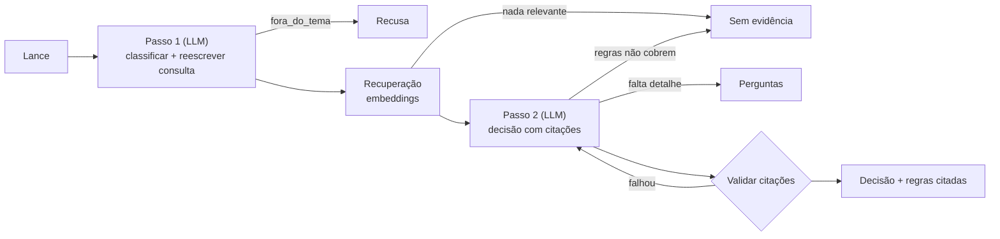

# ⚽ Assistente de Regras de Futebol

Descreva um lance ("o goleiro saiu da área e defendeu com a mão") e o assistente
devolve a **decisão de arbitragem**, a **explicação** e as **regras citadas**,
com base nas Leis do Jogo da IFAB.

## Ideia

| | |
|---|---|
| **Utilizador** | Torcedores, jogadores amadores e árbitros iniciantes que querem entender um lance. |
| **Problema** | As regras são longas e técnicas; discussões sobre lances costumam ignorar o que a regra diz. |
| **Formato** | Chatbot de pergunta única (Streamlit → FastAPI). |
| **Trigger** | O utilizador descreve um lance ou faz uma pergunta sobre as regras. |
| **Informação em falta** | Se a decisão depende de um detalhe não descrito (ex.: dentro ou fora da área), o assistente **pergunta** em vez de presumir. Se as regras não cobrem o tema (ex.: VAR), diz isso em vez de inventar. |

## Fluxo



1. **Classificar** ([app/classify.py](app/classify.py)): categoria do lance
   (impedimento, mão na bola, falta, ...) e uma consulta reescrita com o
   vocabulário do regulamento, que melhora a recuperação.
2. **Recuperar** ([app/retrieval.py](app/retrieval.py)): um chunk por seção das
   regras em [data/regras/](data/regras/), ranking por similaridade de cosseno.
   Os embeddings ficam em cache em `data/.cache/`.
3. **Decidir** ([app/rag.py](app/rag.py)): o modelo usa só as regras recuperadas
   e devolve um schema `Decisao`. O schema põe `citacoes` e `explicacao` antes
   de `decisao`, para o modelo fundamentar antes de concluir.
4. **Validar**: cada citação tem de existir literalmente no trecho citado. Se
   falhar, há uma nova tentativa com os erros como feedback.

Todos os passos usam schemas Pydantic ([app/schemas.py](app/schemas.py)). A
resposta final (`Resultado`) tem um `status`: `respondido`,
`precisa_de_mais_informacao`, `fora_do_tema` ou `sem_evidencia`.

Cada resposta inclui também `metricas` ([app/metrics.py](app/metrics.py)):
latência total, tokens de entrada/saída e custo estimado em USD, com o detalhe
por etapa (classificação, embedding da consulta, decisão e eventual nova
tentativa). O custo usa a tabela `PRICES_PER_MILLION`; para um modelo que não
esteja lá, o custo aparece como `null` / "n/d".

## Como executar

Requisitos: Python 3.10+ e [uv](https://docs.astral.sh/uv/).

```text
# 1. Instalar as dependências
uv sync

# 2. Configurar a chave da OpenAI
cp .env.example .env        # no Windows: copy .env.example .env
# edite o .env e preencha OPENAI_API_KEY

# 3. Arrancar a API (terminal 1)
uv run uvicorn app.api:app --port 8000

# 4. Arrancar a interface (terminal 2) -> abre em http://localhost:8501
uv run streamlit run ui.py
```

A documentação interativa da API fica em http://127.0.0.1:8000/docs.

Também é possível usar pela linha de comandos, sem API nem interface:

```text
uv run python -m app.pipeline "O atacante recebeu a bola de um lateral atrás dos defensores. É impedimento?"
```

## Testes

```text
# Sem chamadas à API: chunking e validação de citações
uv run python tests/test_offline.py

# Avaliação ponta a ponta (chama a API da OpenAI, custa alguns cêntimos)
uv run python tests/run_eval.py
```

[tests/casos.json](tests/casos.json) tem 16 casos: lances com resposta,
lances que precisam de mais detalhes, perguntas fora do tema (incluindo uma
tentativa de prompt injection) e uma pergunta sobre um tema que a base não
cobre. Cada caso verifica o status, a categoria, se a fonte certa foi
recuperada **e** citada, e termos esperados na resposta.

## Limitações

- [data/regras/](data/regras/) é um **resumo** em português de algumas Leis do
  Jogo, não o texto oficial. Para uso real, substitua pelo texto oficial da
  IFAB (theifab.com) - o resto do código não precisa de mudar.
- Faltam leis (duração, campo, VAR, vantagem...). Perguntas sobre elas
  devolvem `sem_evidencia`.
- Índice em memória: adequado para dezenas de regras; para um corpus grande,
  trocar por Chroma (aula 3).
